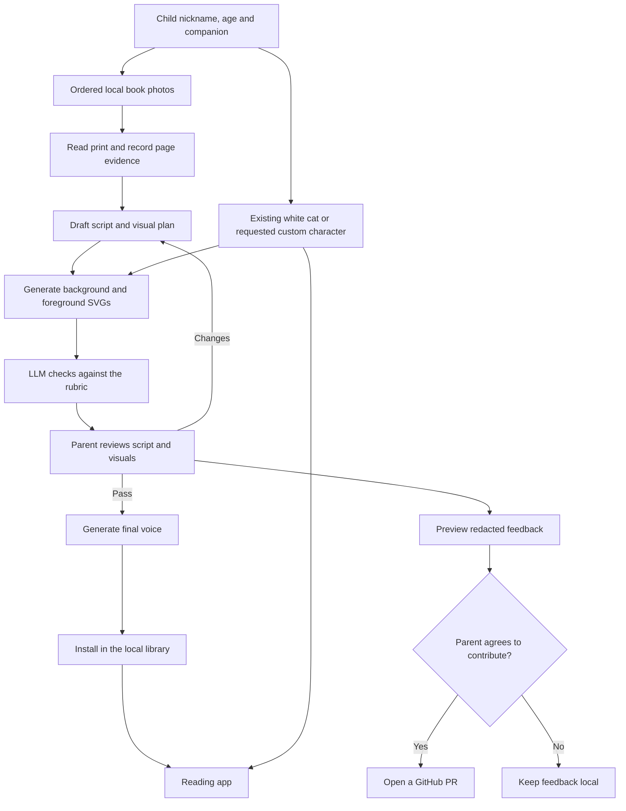

# Read for Xixi

Turn your picture books into interactive reading experiences for toddlers, with an animated companion, playful questions and narration.

[Try the app](https://storyforxixi.susiefan.com/) · [Latest release](https://github.com/susiefan/Read-for-Xixi/releases/latest) · [Parent setup guide](docs/photo-book-workflow.md)

I built Read for Xixi to make it easier for parents to share picture books with young children. It reads a page, offers something to talk about, and leaves time for the child to join in. Mimi is a companion beside the book.

## Why I'm building this

### Reading gets tiring, especially across languages

Parents can be tired and still want to read with their child. Reading an English book in a Mandarin-speaking family, or a Chinese book in an English-speaking family, adds another job: translating as you go. Then there are the questions. What would interest a two-year-old on this page? How do you ask without turning it into a test?

I wanted narration and questions that a family could prepare once and use again. Each page has a reading, one invitation and a short response. The invitation gives the child a starting point. They can point, make a sound, act something out or say a few words. The original text is kept separate from any translation.

The questions matter. [Research on caregiver book-sharing](https://pubmed.ncbi.nlm.nih.gov/30737957/) has found benefits for children's language, and the [AAP recommends reciprocal, language-rich shared reading](https://publications.aap.org/pediatrics/article/doi/10.1542/peds.2024-069090/199467/Literacy-Promotion-An-Essential-Component-of). That's why I built in chances to talk and respond. Those studies looked at shared reading with caregivers; they don't establish that this app has the same effects.

The current prompts focus on Mandarin. Switching the interface to English changes the menus and book metadata, not the narration.

### Ordinary books can be hard to keep interesting

Young children can lose interest quickly. Flaps and sound buttons give them something to do, but buying a special-format book for every topic can get expensive. I wanted families to get more out of the books they already have.

Read for Xixi adds small things to do while reading: look for a clue, copy a sound, pretend to drive, describe what happened or notice how a character feels. The visuals follow the page. A favourite animal can be the reading partner. Existing scripts, artwork and audio can be reused instead of made again.

### I want the child looking at the physical book

Many children under five can't yet read the words by themselves. A screen can help with narration, but it can also pull attention away from the book.

I made the companion's movements small. It blinks, breathes and holds a book facing itself. It stays in place when the page changes and stops following the mouse during reading. The invitations send the child back to the page or ask them to do something with their hands or voice.

In my early user research with **five children aged 2 to 4**, the children mainly looked at the physical book. The character seemed to help them stay engaged without becoming the main thing they watched. This was a small observation, not a controlled study of attention or language outcomes.

## Make a book from your photos

The [setup skill](skills/setup-picture-book) runs the local workflow with a coding assistant. Give it a folder of book-page photos. It first asks:

- What should the companion call your child?
- How old is your child?
- Which companion would your child like?

Then it checks the page order and the available model and voice setup. It reads the printed text before interpreting the pictures, flags uncertain text and drafts the reading, invitation, response and visual plan. A separate visual agent makes transparent, flat-colour SVG backgrounds and props from that plan and the original page.

You review the result in the local evaluation app. The original photo, script, translation and scene are on the left. Scores and comments are on the right. Scripts use a 1 to 7 scale, with 4 as the pass mark; visuals use pass or fail. One button saves the page and moves on.

If something needs changing, the assistant revises that part. An unchanged script or visual keeps its earlier rating, with a record of where the rating came from. Changed wording, translations or artwork need a new review. Final voice generation starts only when the current pages pass your review.

The finished book is installed in your local reader. This workflow needs a repository checkout, access to the chosen generation models and a configured CosyVoice environment. The public demo lets you try reading; it isn't a website for uploading book photos.

[Copy the full parent prompt](prompts/photo-book-workflow.md) · [Read the setup guide](docs/photo-book-workflow.md)

## Choose a companion

I made the three cats below and have included their artwork, rigs and code under the [MIT license](LICENSE). You can use, change and share them while keeping the copyright and license notice.

| Companion | What it looks like | Where to choose it |
|---|---|---|
| Mimi · 3D | A cream-coloured cat with rounded shapes, a held book, blinking, breathing and speaking motion. | Settings → Mimi · 3D. Glasses can be off, black frames or blue goggles. |
| White cat · Animated 2D | A soft white cat with pink ears, green eyes and a lavender book. Its small speaking mouth keeps the upper smile in place. | Settings → 白猫 · 动画 2D / White cat · Animated 2D. [Existing artwork](app/WhiteCatArtwork.tsx). |
| Mimi · 2D | The classic grey/taupe illustrated cat, with a reading book and story props. | Settings → Mimi · 2D / 原版 2D. |

The [white-cat prompt](prompts/reading-avatar.md) reuses the existing character. It doesn't ask for a redesign.

If your child wants another animal, the [avatar skill](skills/create-reading-avatar) can make a JSON character file from their preferences. Import it in Settings. The app adds blinking, breathing and a speaking mouth. Up to six custom companions can be saved in that browser. Changing the character doesn't change the book or voice.

For the separate Cubism cat, see [Live2D's Tororo & Hijiki sample](https://www.live2d.com/en/learn/sample/tororo-hijiki/) and [its terms](https://www.live2d.com/en/learn/sample/model-terms/). Tororo is the white cat. That sample belongs to Live2D and has its own terms. The white cat in this open-source package is my SVG character and doesn't need Cubism.

## How the parts fit together



| Part | What it does |
|---|---|
| Browser reader | React, TypeScript and Vite handle the library, reading flow and controls. Three.js and SVG animate the companions. Preferences, stars and imported characters are saved in the browser. |
| Photo and library tools | Python, Pillow and PDFium prepare ordered pages, preserve source hashes and import completed books. |
| Authoring and visual agents | Configured Responses API models use the original page images and separate prompts to produce structured scripts and SVGs. |
| LLM judge | Checks the source, language, interaction and artwork. Definite errors can trigger up to three corrections. A preference alone doesn't force a rewrite. |
| Evaluation app | A local Python HTTP server, SQLite and HTML/CSS/JS show the page and collect separate script and visual ratings. |
| Final voice | A separately installed CosyVoice environment renders the accepted words with the approved voice profile. Jobs can resume without repeating completed tracks. |
| Feedback contribution | Exports a local preview, checks permission for that exact file and opens a PR from an isolated clone or fork. |
| Progress dashboard | Reads the requirements, task history and local job status, with a refresh button. |

Book photos, child profiles and working reviews stay in ignored `data/local/`. The playable book goes in ignored `public/library/`. The evaluation server runs on loopback. Optional generation sends the supplied pages and relevant profile to the configured model API; keys stay in the server environment.

The source reader has buttons, replay, pause and autoplay. Autoplay leaves a fixed five seconds for conversation, then plays the response and waits 1.5 seconds before the next page. It doesn't listen to the child or detect a physical page turn.

## The reviews behind the rubric

I've included **207 of my saved editorial reviews**: 102 script ratings, 91 visual ratings and 14 earlier overall ratings. The [dataset](evals/contributions/maintainer-feedback-v1.json) contains scores, redacted comments and page/version metadata. It leaves out the book pages, full scripts, audio and child profiles.

I kept the old overall scores separate. Some visual passes may have come from saving the form's default selection, so those records carry a flag. Without the private source pages and scripts, this dataset isn't enough to rerun the original reviews on its own.

The [judge rubric](prompts/interaction-judge.md) covers the things I kept correcting: read the story before interpreting a pose, use natural Mandarin, notice an important event or feeling, keep the response connected to the invitation, avoid giving away the next page, and make props fit the scene. Funny details, colours, numbers and manners can all be good topics. The judge shouldn't reject a good answer just because it prefers different wording.

Other parents can contribute their reviews too. The assistant first shows the redacted file, the destination and the MIT contribution terms. It uploads only after the parent explicitly agrees to that exact file hash. Saying no doesn't hold up the book or its voice generation.

## Run it locally

You need Node.js 22.12+, pnpm 11.25.0 and Python 3.11+.

```bash
git clone https://github.com/susiefan/Read-for-Xixi.git
cd Read-for-Xixi
corepack enable
corepack prepare pnpm@11.25.0 --activate
pnpm install --frozen-lockfile
python3 -m venv .venv
source .venv/bin/activate  # Windows: .venv\Scripts\activate
pip install -r requirements.txt
pnpm dev
```

Open the address printed in the terminal, usually http://127.0.0.1:5173. The reader starts with an import prompt until you add a book. The original cats can be shown on their own. Running the reader needs no API key and doesn't generate content or audio.

### Import a completed local book library

The importer reuses two books from my existing library: *Pip and Posy: The Christmas Tree* and *Pip and Posy: The Bedtime Frog*. Each has 13 pages and 39 audio tracks. Their selection metadata is in [examples/library-selection.json](examples/library-selection.json); their complete contents stay local.

```bash
python scripts/import_existing_library.py /path/to/your/storyspark-app
python scripts/check_existing_library.py
pnpm dev
```

This expects an existing StorySpark folder with `public/local-private/books.json`, `public/audio`, the referenced scene assets and page evidence in `data/local/script-evals`. Source PDFs are read from the neighbouring book-page folder, or from `--source-dir /path/to/pdfs`. The importer checks the printed text and copies the accepted scripts, artwork and audio into ignored `public/library/` and `data/local/`. It doesn't call a model or change the recordings.

To import other completed books, update the selection file. To make a book that hasn't been prepared yet, use the photo workflow below. The source repository does not include the commercial books, scans, story-specific art or voiceovers.

### Make a book from your photos

Copy `skills/setup-picture-book` and `skills/create-reading-avatar` into your assistant's skill directory, keeping their reference files and metadata. For Codex, that is `~/.codex/skills/`. Work from this repository checkout, then use this prompt or the [full example](prompts/photo-book-workflow.md):

```text
Use $setup-picture-book with my folder of book photos.
Ask for my child's nickname, age and companion preference first.
Use the existing white cat if that is my choice.
Show the scripts and assets for my review before making the final voices.
Ask before contributing any of my feedback to GitHub.
```

The CLI runs the same steps:

```bash
python scripts/photo_book_workflow.py prepare /path/to/photos \
  --book-id my-book --title 'My book' \
  --child-name "Your child's nickname" --age-months 24 --character white-2d
python scripts/photo_book_workflow.py build data/local/books/my-book \
  --model YOUR_AVAILABLE_MODEL --visual-model YOUR_AVAILABLE_VISUAL_MODEL
python evals/webapp/serve.py
# Review at http://127.0.0.1:4327/ and revise the pages that need changes.
python scripts/photo_book_workflow.py check-review data/local/books/my-book
python scripts/photo_book_workflow.py voice data/local/books/my-book --lab /path/to/tts-lab
pnpm dev
```

Use your child's nickname and age in months. For a custom character, supply `--avatar-file` during preparation and import the same JSON in Settings. The [workflow guide](docs/photo-book-workflow.md) explains photo order, revisions, model and CosyVoice setup, and feedback permission. Generation uses your configured server-side API key and the model names you provide; final speech uses a separately installed CosyVoice lab. Those tools aren't needed just to play an existing book.

You can validate a custom character before importing it:

```bash
pnpm avatar:validate my-companion.avatar.json --preview preview.svg
```

## Review pages and track progress

Start `python evals/webapp/serve.py`, then open:

| Address | What you can do |
|---|---|
| http://127.0.0.1:4327/ | Review the original image, script, translation and composed scene on the left. Give a script score, visual pass/fail and comments on the right. Save and Next saves both ratings. |
| http://127.0.0.1:4327/production | Check local book and voice-generation jobs. |
| http://127.0.0.1:4327/open-source | See requirements, tasks, evidence and project history, with manual or automatic refresh. |

Run `python scripts/review_loop.py` to prepare targeted revisions. Passing, unchanged work keeps its saved rating. Changed wording, translations or visual files need a review of the new content. The judge can retry a definite error up to three times; it shouldn't reject a good response because it prefers a different phrase or colour.

Reviews are stored locally in SQLite and separate Markdown feedback files. [Evaluation details](docs/evaluation.md) explain the hashes, inherited ratings and limits of the published review set.

## What is included

The repository contains the reading app, my three original cats, the photo-book and avatar skills, authoring prompts, separate visual and voice prompts, the LLM judge rubric, the evaluation app, the progress dashboard, book-package tools, tests and design notes. The [release downloads](https://github.com/susiefan/Read-for-Xixi/releases/latest) also provide the skills and prompts as separate files, with a publication manifest and validation report.

| Guide | Start here for |
|---|---|
| [Photo-book workflow](docs/photo-book-workflow.md) | Turning an ordered photo folder into a reviewed book and final narration. |
| [Companions](docs/custom-companions.md) | Using the white cat, importing a custom animal and finding Live2D's separate sample cat. |
| [Authoring](docs/authoring.md) | Source-text handling, script generation and separate visual/voice steps. |
| [Evaluation](docs/evaluation.md) | Scoring, feedback and revisions. |
| [System design](design/README.md) | Components, reading state, production flow, storage and deployment. |
| [Book format](schemas/book-package.schema.json) | The portable book-package contract. |
| [Deployment](docs/deployment.md) | Building and hosting the static reader and running local tools. |

## Checks and current scope

```bash
pnpm test
python -m unittest discover -s tests -v
pnpm build
pnpm check:release
```

The v0.3.0 release passed 25 automated tests, TypeScript typechecking, Python compilation, SVG/JSON checks, skill validation, the production build and [GitHub CI](https://github.com/susiefan/Read-for-Xixi/actions/runs/44854600015). Workflow tests used local fixtures and mocked model responses. I didn't run a new parent book through paid generation and final TTS for that release.

The source reader does not include voice control, automatic page recognition, live speech understanding, child assessment, cloud sync or a native iPhone installer. The 100-case benchmark and Bloom/H5P integration are still planned.

## Contribute and license

Useful contributions include other library importers, language improvements, accessibility fixes, original scene parts and test cases with clear sources. See [CONTRIBUTING.md](CONTRIBUTING.md) for the writing standards and checks.

My project code and original companion artwork are available under [MIT](LICENSE). Keep the copyright and license notice when using them. Third-party dependencies, Live2D's sample and the books have their own terms. See [ATTRIBUTION.md](ATTRIBUTION.md) for credits and [SECURITY.md](SECURITY.md) for reporting a security issue.

## Complete file guide

The table covers the tracked source files. Research and older privacy notes describe some ideas that are not implemented.

| File | What it does |
|---|---|
| [.github/workflows/ci.yml](.github/workflows/ci.yml) | GitHub CI: install dependencies, run TypeScript/Python tests, compile Python, build the reader and audit publication scope. |
| [.gitignore](.gitignore) | Excludes private book resources, local reviews, keys, virtual environments and builds; explicitly includes the evaluation UI source directory named dist. |
| [ATTRIBUTION.md](ATTRIBUTION.md) | Explicit original-art credits, MIT permissions I grant for my own cats, separate Live2D/book rights and consented editorial feedback provenance. |
| [CONTRIBUTING.md](CONTRIBUTING.md) | Contribution scope, interaction-writing standards, provenance expectations and validation guidance. |
| [LICENSE](LICENSE) | MIT license for project code and original companion artwork. |
| [README.md](README.md) | Project purpose, live try-it URL, parent skills/prompts, install/import/reading/evaluation entry points and open-source boundaries. |
| [SECURITY.md](SECURITY.md) | Security reporting, local-data boundaries, optional API processing and deployment limitations. |
| [app/AnimatedWhiteCat.tsx](app/AnimatedWhiteCat.tsx) | Animation controller for the white SVG cat: blinking, breathing, ears, pupils and audio-driven mouth; disables pointer following while reading. |
| [app/AvatarImporter.tsx](app/AvatarImporter.tsx) | Settings import/remove controls and browser-local avatar-library state; validates files before use and reports storage failures. |
| [app/CustomReadingAvatar.tsx](app/CustomReadingAvatar.tsx) | Animates a validated custom vector companion: blinking, gentle breathing/ears and playback-driven mouth; no cursor following. |
| [app/Live2DMimi.tsx](app/Live2DMimi.tsx) | Original SVG Mimi illustration, reading book, glasses and reusable story-prop drawings; this is custom animated 2D artwork, not a Cubism model. |
| [app/Live3DMimi.tsx](app/Live3DMimi.tsx) | React wrapper that lazily mounts/disposes the Three.js companion and composes optional reading-scene layers. |
| [app/OpenReader.tsx](app/OpenReader.tsx) | Main library/settings/reading UI; owns selected book, audio lifecycle, page navigation, autoplay, star totals and UI-language choice. |
| [app/ReadingAvatarArtwork.tsx](app/ReadingAvatarArtwork.tsx) | Pure React SVG renderer for allowlisted avatar geometry; shared by the UI and command-line SVG preview. |
| [app/ReadingSceneLayer.tsx](app/ReadingSceneLayer.tsx) | Renders positioned scene layers; preloads and crossfades backgrounds without remounting the companion. |
| [app/WhiteCatArtwork.tsx](app/WhiteCatArtwork.tsx) | White-cat SVG artwork with named rig parts, glasses variants, paws and a book facing the cat. |
| [app/classicCat.css](app/classicCat.css) | Original 2D cat breathing, blinking, mouth, paw and prop animation rules, including reduced-motion handling. |
| [app/customAvatar.css](app/customAvatar.css) | Positioning and accessible import-control styles for custom companions. |
| [app/interfaceLanguage.tsx](app/interfaceLanguage.tsx) | Companion accessibility/status text translations and the language context provider. |
| [app/mimi3d.css](app/mimi3d.css) | 3D stage/canvas and companion-related layout styles retained from the reading app. |
| [app/mimi3dScene.ts](app/mimi3dScene.ts) | Procedural Three.js geometry, materials, lighting, book/props, animation and pointer/reading-state behavior. |
| [app/openReader.css](app/openReader.css) | Consumer reading layout, fixed companion stage, book cards, controls, typography and responsive styles. |
| [app/readingAvatar.ts](app/readingAvatar.ts) | Strict data-only avatar contract/parser, safe shape/attribute limits, ID replacement and six-avatar local-library helpers. |
| [app/readingFlow.ts](app/readingFlow.ts) | Small pure helpers for post-audio phases, bounded page navigation and safe stored-star parsing. |
| [app/readingScene.css](app/readingScene.css) | Scene depth, fade-in, reusable prop motions and reduced-motion styles. |
| [app/types.ts](app/types.ts) | Shared TypeScript contracts for books, spreads, scenes/layers, props, moods and related compatibility data. |
| [app/webRuntime.ts](app/webRuntime.ts) | Public-build detection, asset-path prefixing and local-host helpers. |
| [app/whiteCat.css](app/whiteCat.css) | White-cat artwork sizing and stage positioning. |
| [app/whiteCatRig.ts](app/whiteCatRig.ts) | Pure calculations for white-cat pose, gaze smoothing, blinking and mouth shape. |
| [confidential/README.md](confidential/README.md) | Explains private-content categories and repository exclusion conventions; this directory contains documentation/templates only. |
| [confidential/books/README.md](confidential/books/README.md) | Describes private book input/page-map organization and handling. |
| [confidential/books/book-manifest.example.json](confidential/books/book-manifest.example.json) | Synthetic example of a private book manifest; not a complete book or a shipped content pack. |
| [confidential/child-profiles/README.md](confidential/child-profiles/README.md) | Documents privacy and interpretation boundaries for possible caregiver-approved interaction observations. |
| [confidential/child-profiles/interaction-profile.example.json](confidential/child-profiles/interaction-profile.example.json) | Synthetic example interaction profile, not real family data. |
| [confidential/generated-audio/README.md](confidential/generated-audio/README.md) | Documents private generated-audio storage and associated timing/version metadata. |
| [confidential/session-recordings/README.md](confidential/session-recordings/README.md) | Describes boundaries for optional future research recordings; the current reader does not record sessions. |
| [confidential/voices/README.md](confidential/voices/README.md) | Documents privacy/consent expectations for possible voice inputs; no recordings, embeddings or consent documents are included. |
| [data/knowledge/book-series.json](data/knowledge/book-series.json) | Empty, extensible series-knowledge container in the public version; private character/series knowledge is not bundled. |
| [data/knowledge/child-development.json](data/knowledge/child-development.json) | Referenced age-band reading guidance and source links retained as authoring knowledge; not a diagnostic model or automatically inferred child assessment. |
| [data/knowledge/companion-expressions.json](data/knowledge/companion-expressions.json) | Empty per-book expression-mapping container; does not contain private book expression annotations. |
| [data/open-source-release.json](data/open-source-release.json) | Requirements, tasks, acceptance criteria, evidence and progress history used by the dashboard. The tag captures the pre-publication snapshot; main contains the final completion record. |
| [data/templates/child-profile.example.json](data/templates/child-profile.example.json) | Synthetic profile-format example for age, languages, preferences and acceptable participation/support; not a real child record or an implemented profiling service. |
| [data/voices/mimi-instruct2.json](data/voices/mimi-instruct2.json) | Versioned approved Mimi TTS configuration: model/method, instruction, instruction hash and seed; contains no reference recording or model weights. |
| [design/README.md](design/README.md) | System-design overview, component/data-flow diagram and links to the focused design notes. |
| [design/book-production.md](design/book-production.md) | Existing-book reuse versus optional authoring; agent roles, grading, targeted retries and final-stage audio design. |
| [design/data-and-deployment.md](design/data-and-deployment.md) | Published/local-only storage boundaries, static-reader versus local-review service and package-integrity design. |
| [design/reading-runtime.md](design/reading-runtime.md) | Reading state machine, audio cancellation, existing track naming, companion continuity, language handling and browser persistence. |
| [docs/authoring.md](docs/authoring.md) | Optional contributor workflow for authorized PDFs, source verification, page regeneration, separate prompts and last-stage TTS; not needed for existing-library import. |
| [docs/custom-companions.md](docs/custom-companions.md) | Each original companion, how to select/reuse the existing white cat, optional custom imports, skill installation and official Live2D sample links. |
| [docs/deployment.md](docs/deployment.md) | Static build/hosting instructions, local services, dashboard operation and release-verification scope. |
| [docs/evaluation.md](docs/evaluation.md) | Scoring rules, revision hashes, local feedback archives and how failed dimensions become regeneration work. |
| [docs/photo-book-workflow.md](docs/photo-book-workflow.md) | Parent onboarding and complete photos → script/assets → review → optional contribution → final voice → local install guide. |
| [docs/why-read-for-xixi.md](docs/why-read-for-xixi.md) | The three caregiver/book-attention problems, corresponding design choices, primary research links and the creator-reported five-child observation. |
| [evals/README.md](evals/README.md) | Entry guide to local evaluation, scoring, versioned feedback and deterministic checks. |
| [evals/check_interaction_scripts.py](evals/check_interaction_scripts.py) | Printed-text/page-order checks plus review warnings for repeated invitations, missing support cues, complex wording and possible spoilers; can write a Markdown review sheet. |
| [evals/contributions/README.md](evals/contributions/README.md) | Consent/provenance, record counts, limitations and editorial lessons from the real maintainer evaluation set. |
| [evals/contributions/maintainer-feedback-v1.json](evals/contributions/maintainer-feedback-v1.json) | 207 explicitly owner-authorized, redacted human review records: 102 script, 91 visual, 14 legacy overall; no underlying book scripts/scans/audio or child profiles. |
| [evals/interaction-script-manual-eval.md](evals/interaction-script-manual-eval.md) | Detailed editorial rubric and illustrative interaction examples from the authoring workflow; guidance, not a database of real user scores or proof of automatic personalization. |
| [evals/live2d_quality.py](evals/live2d_quality.py) | SVG rendering/transparency inspection and bounded asset-check helpers; separates blocking defects from non-blocking suggestions. |
| [evals/webapp/README.md](evals/webapp/README.md) | Local review-server setup, URLs, score handling and private-data notes. |
| [evals/webapp/dist/app.css](evals/webapp/dist/app.css) | Responsive side-by-side review layout, rating controls, source-image view and visual-stage styling. |
| [evals/webapp/dist/app.js](evals/webapp/dist/app.js) | Review UI behavior: book/version/page selection, preview composition, score forms and combined Save and Next. |
| [evals/webapp/dist/index.html](evals/webapp/dist/index.html) | Review-page structure: source material and visual preview beside script/visual ratings and comments. |
| [evals/webapp/dist/mimi.svg](evals/webapp/dist/mimi.svg) | Original static Mimi artwork used as a shared visual preview/reference inside the evaluation tool. |
| [evals/webapp/dist/open-source.css](evals/webapp/dist/open-source.css) | Dashboard task cards, requirement lists, status badges and responsive layout. |
| [evals/webapp/dist/open-source.html](evals/webapp/dist/open-source.html) | Requirements/release dashboard page structure. |
| [evals/webapp/dist/open-source.js](evals/webapp/dist/open-source.js) | Loads dashboard status, computes progress, filters tasks and handles manual/automatic refresh. |
| [evals/webapp/dist/production.html](evals/webapp/dist/production.html) | Optional production-batch dashboard page structure; shows an empty state without local batch records. |
| [evals/webapp/dist/production.js](evals/webapp/dist/production.js) | Reads local production-status records, displays checked/installed books and audio progress, and refreshes status. |
| [evals/webapp/serve.py](evals/webapp/serve.py) | Local review server and SQLite ratings; includes translation in script hashes, content-based visual hashes, verified unchanged-grade inheritance and private source/scene/dashboard endpoints. |
| [examples/library-selection.json](examples/library-selection.json) | IDs, titles, English UI metadata and draft keys for the two existing local books; contains no complete book text, scans, art or audio. |
| [index.html](index.html) | Vite HTML entry: document metadata, favicon, React root and the web/main.tsx module. |
| [package.json](package.json) | App version, Node/pnpm requirements, dependency declarations and dev/build/test/evaluation commands. |
| [pnpm-lock.yaml](pnpm-lock.yaml) | Resolved Node dependency graph used by frozen-lockfile installs. |
| [pnpm-workspace.yaml](pnpm-workspace.yaml) | Explicit build-script allowances for esbuild and the SVG renderer dependency. |
| [prompts/authoring.md](prompts/authoring.md) | Authoring rules carried forward from the v42 workflow: preserve printed text, use page evidence, natural Mandarin, one mandatory invitation, first-level support, no spoilers and concise responses. |
| [prompts/interaction-judge.md](prompts/interaction-judge.md) | Shared LLM judge rubric informed by actual feedback: calibrated score definitions, material errors versus suggestions, language/evidence/empathy/spoiler checks and visual quality. |
| [prompts/photo-book-workflow.md](prompts/photo-book-workflow.md) | Copyable parent prompt that supplies a photo folder, asks nickname/age/companion, requests evaluation before voice and makes GitHub contribution optional/consented. |
| [prompts/reading-avatar.md](prompts/reading-avatar.md) | Prompt to reuse the existing exact white-cat artwork/rig first, with an optional explicit custom-animal JSON contract and official Live2D links. |
| [prompts/visual-assets.md](prompts/visual-assets.md) | Separate visual-agent instructions for image-grounded, book-colour-matched, flat (平涂), transparent SVG scenery/props with coherent placement and physical support. |
| [prompts/voice.md](prompts/voice.md) | Voice-agent contract describing exact-text preservation and separate narration/invitation/response tracks; the public audio-manifest builder enforces its track plan deterministically. |
| [public/apple-touch-icon.png](public/apple-touch-icon.png) | Apple home-screen icon asset. |
| [public/assets/mimi3d/catalog.json](public/assets/mimi3d/catalog.json) | Catalog of original procedural 3D scenes, props, wearables, renderer source and framing/style conventions. |
| [public/favicon.svg](public/favicon.svg) | SVG browser favicon referenced by the HTML entry. |
| [public/icon-192.png](public/icon-192.png) | 192-pixel application icon asset. |
| [public/icon-512.png](public/icon-512.png) | 512-pixel application icon asset. |
| [public/manifest.webmanifest](public/manifest.webmanifest) | Web-app installation metadata and icon references; included as an asset, not a native iPhone installer. |
| [public/read-for-xixi-logo.svg](public/read-for-xixi-logo.svg) | Project logo artwork. |
| [release/history-audit.json](release/history-audit.json) | Pre-release audit result for 21 historical commits and 48 reachable blobs; reports credential findings without printing secrets. |
| [release/validation-v0.3.0.json](release/validation-v0.3.0.json) | Actual v0.3 validation: 25 automated tests, compiler/build/skills checks, consent/review gates, native Sites deployment and explicitly untested paid-generation paths. |
| [release/validation.json](release/validation.json) | Validation snapshot: clean install, test counts, compile/build results, local-book integrity and explicitly unperformed checks. The separately attached validation JSON also records the successful release-commit CI run. |
| [requirements.txt](requirements.txt) | Pinned top-level Python dependencies for PDF rendering, images and JSON Schema validation. |
| [research/01-executive-synthesis.md](research/01-executive-synthesis.md) | High-level synthesis of shared-reading evidence and implications for the product concept. |
| [research/02-shared-reading-and-language.md](research/02-shared-reading-and-language.md) | Notes on interactive reading, language, reading routines and evidence limits. |
| [research/03-sign-language-and-chinese-signing.md](research/03-sign-language-and-chinese-signing.md) | Archived research on signs/gestures and Chinese reading; not an implemented sign-language avatar. |
| [research/04-parent-barriers-and-expert-cost.md](research/04-parent-barriers-and-expert-cost.md) | Research notes on caregiver time, fatigue, confidence and access barriers. |
| [research/05-avatar-ai-feasibility-and-safety.md](research/05-avatar-ai-feasibility-and-safety.md) | Earlier avatar/AI feasibility and safety exploration, including signing complexity; not a description of shipped signing capability. |
| [research/06-landscape-and-opportunity.md](research/06-landscape-and-opportunity.md) | Directional landscape of related projects and possible contribution opportunities. |
| [research/07-parent-voice-and-toddler-response.md](research/07-parent-voice-and-toddler-response.md) | Background on familiar voices, child-directed delivery and conversational participation. |
| [research/08-3d-cat-asset-review.md](research/08-3d-cat-asset-review.md) | Earlier checklist for a reading-cat production asset: rig, animation, framing and interaction requirements. |
| [research/09-natural-voice-and-parent-voice-cloning.md](research/09-natural-voice-and-parent-voice-cloning.md) | Voice-quality and potential parent-voice design notes; does not ship a consent or cloning service. |
| [research/10-adaptive-child-response-system.md](research/10-adaptive-child-response-system.md) | Exploratory interaction-profile/adaptation design; not an active child-assessment or speech-understanding system in this release. |
| [research/README.md](research/README.md) | Index of the research notes and their intended product/design context. |
| [research/sources.md](research/sources.md) | Source ledger with links, evidence types and limitations. |
| [schemas/book-package.schema.json](schemas/book-package.schema.json) | Version 1 JSON Schema for portable book metadata, licensing fields, localized copy, page text, separate Mandarin narration and page-level visual plans. |
| [schemas/reading-avatar.schema.json](schemas/reading-avatar.schema.json) | Versioned JSON Schema for portable, data-only animated companion geometry, palette, rig parts, metadata and dimensions. |
| [scripts/audio_job_state.py](scripts/audio_job_state.py) | Shared atomic-JSON writing and UTC timestamp helpers for job/status records. |
| [scripts/audit_release.py](scripts/audit_release.py) | Audits Git-eligible files for excluded private/generated paths, symlinks, large binaries and credential-like strings; can produce a publication manifest. |
| [scripts/book_package.py](scripts/book_package.py) | Validates the portable package contract, printed-text locks, page IDs, source hash and SVG structure; exports/imports ZIP packages with hashes and archive path/count/size/symlink checks. |
| [scripts/build_package_manifest.py](scripts/build_package_manifest.py) | Deterministically derives exact story/invitation/response speech tracks and a script hash from an accepted package, without asking a model to rewrite the text. |
| [scripts/check_existing_library.py](scripts/check_existing_library.py) | Checks imported text against the source library, verifies copied-file SHA-256 hashes and checks existing WAV structure/duration, including floating-point WAVs. |
| [scripts/contribute_evals.py](scripts/contribute_evals.py) | Validates text-only feedback and requires an approval matching its exact hash/repository/license before using an isolated clone/fork to open a contribution PR. |
| [scripts/export_eval_contribution.py](scripts/export_eval_contribution.py) | Creates a local-only feedback preview from saved ratings/comments; redacts names/contact/paths and anonymizes book keys by default. |
| [scripts/generate_audio.py](scripts/generate_audio.py) | Low-level CosyVoice instruct2 worker: validates the voice instruction hash, uses stable per-track seeds and writes WAVs atomically with progress updates. |
| [scripts/import_existing_library.py](scripts/import_existing_library.py) | Imports the two selected completed books from the existing StorySpark directory format; reuses scripts/SVG/WAV bytes, renders source-page previews and writes ignored local resources plus integrity receipts. |
| [scripts/init_book.py](scripts/init_book.py) | Optional scaffold for an authorized PDF: extracts provisional text and selected page order into local evidence/package files; placeholders require completion and text needs checking. |
| [scripts/llm_judge.py](scripts/llm_judge.py) | Structured judge API/schema and scope-aware material-finding policy; preference-only findings do not force regeneration. |
| [scripts/openai_responses.py](scripts/openai_responses.py) | Server-side Responses API adapter for structured JSON output; reads OPENAI_API_KEY from the environment and handles provider/JSON errors. |
| [scripts/photo_book_workflow.py](scripts/photo_book_workflow.py) | Family profile and ordered-photo preparation, original-image transcription, script/asset production, versioned review, current-parent-review gate, final voice launch and local reading-library installation. |
| [scripts/prepare_examples.py](scripts/prepare_examples.py) | Compatibility entry point: imports an explicitly supplied existing library or reports that a local import is already available; does not create books. |
| [scripts/regenerate_page.py](scripts/regenerate_page.py) | Image-first targeted page regeneration: author script/visual plan together, create separate behind/front SVGs, judge a composed scene with the actual companion reference and keep accepted work on bounded failure. |
| [scripts/release_status.py](scripts/release_status.py) | Updates the repository release-dashboard JSON, task evidence and status history. |
| [scripts/render_package_audio.py](scripts/render_package_audio.py) | Optional final-stage CosyVoice job launcher: checks package/voice identity, locks one book, calls a separately installed TTS environment and records completion for resumable jobs. |
| [scripts/review_loop.py](scripts/review_loop.py) | Reads saved, revision-matched human grades; exports only failed dimensions as regeneration targets, keeps passing comments as optional suggestions and writes a separate local Markdown feedback archive. |
| [scripts/validate_avatar.ts](scripts/validate_avatar.ts) | Validates an avatar with the browser parser and optionally exports a self-contained SVG preview, without running imported code. |
| [skills/create-reading-avatar/SKILL.md](skills/create-reading-avatar/SKILL.md) | Reusable agent skill: select the existing white cat unchanged, or create an importable original animal only when a custom appearance is requested. |
| [skills/create-reading-avatar/agents/openai.yaml](skills/create-reading-avatar/agents/openai.yaml) | Discovery/display metadata and invocation prompt for the avatar skill. |
| [skills/create-reading-avatar/references/avatar-format.md](skills/create-reading-avatar/references/avatar-format.md) | Self-contained avatar-file contract, drawing limits, layer/rig rules, import behavior and caregiver ownership boundaries. |
| [skills/setup-picture-book/SKILL.md](skills/setup-picture-book/SKILL.md) | Parent workflow skill: ask nickname, age and companion, orchestrate photos/scripts/assets/evaluation, consented feedback contribution and final voice after review. |
| [skills/setup-picture-book/agents/openai.yaml](skills/setup-picture-book/agents/openai.yaml) | Discovery/display metadata and invocation prompt for the parent setup skill. |
| [skills/setup-picture-book/references/workflow.md](skills/setup-picture-book/references/workflow.md) | Runnable workflow commands, source ordering, environment setup, targeted revisions, contribution consent and final voice/install contract. |
| [tests/fixtures/avatar-v1.json](tests/fixtures/avatar-v1.json) | Minimal synthetic geometry fixture for parser/render tests; not a new production character or book. |
| [tests/readingAvatar.test.ts](tests/readingAvatar.test.ts) | Six tests for avatar import/rendering, active-content rejection, geometry/size limits, safe ID updates, capacity and escaped metadata. |
| [tests/readingFlow.test.ts](tests/readingFlow.test.ts) | Three tests covering reading-phase/page-navigation behavior, stored-star parsing and finite white-cat pose/mouth calculations over long sessions. |
| [tests/test_packages.py](tests/test_packages.py) | Nine tests covering package round trips, printed-text locks, traversal/tamper rejection, SVG safety/transparency, distribution of review UI files and preservation of passing review dimensions. |
| [tests/test_photo_workflow.py](tests/test_photo_workflow.py) | Seven tests for offline preparation/order/profile, transcription-before-authoring, final-voice gates, stale content rejection, unchanged-grade reuse, exact contribution consent and nonblocking judge preferences. |
| [tsconfig.json](tsconfig.json) | TypeScript compiler settings and the reading/test entry points included in typechecking. |
| [vite.config.ts](vite.config.ts) | React/Vite setup, static-browser environment flags and production output configuration. |
| [web/main.tsx](web/main.tsx) | Mounts the React reading app in StrictMode. |
