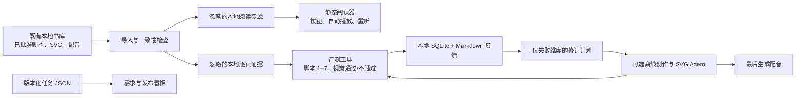

# Read for Xixi system design

本次候选版本将通用工具与本地书库分开。公开仓库包含阅读器、原创猫咪、导入工具、Schema、提示、评测服务与发布看板。用户选择现有《圣诞树》《最心爱的玩具》作为本地演示，不新建书，不把完整书包上传 GitHub。

- [阅读运行时](reading-runtime.md)
- [制作和评审](book-production.md)
- [数据、隐私和发布边界](data-and-deployment.md)

本地复制既有书不会调用模型。付费 API 仅由显式运行离线 regenerate_page.py 发起，密钥只从服务端环境读取。机器检查不等于儿童测试或学习效果证据。
