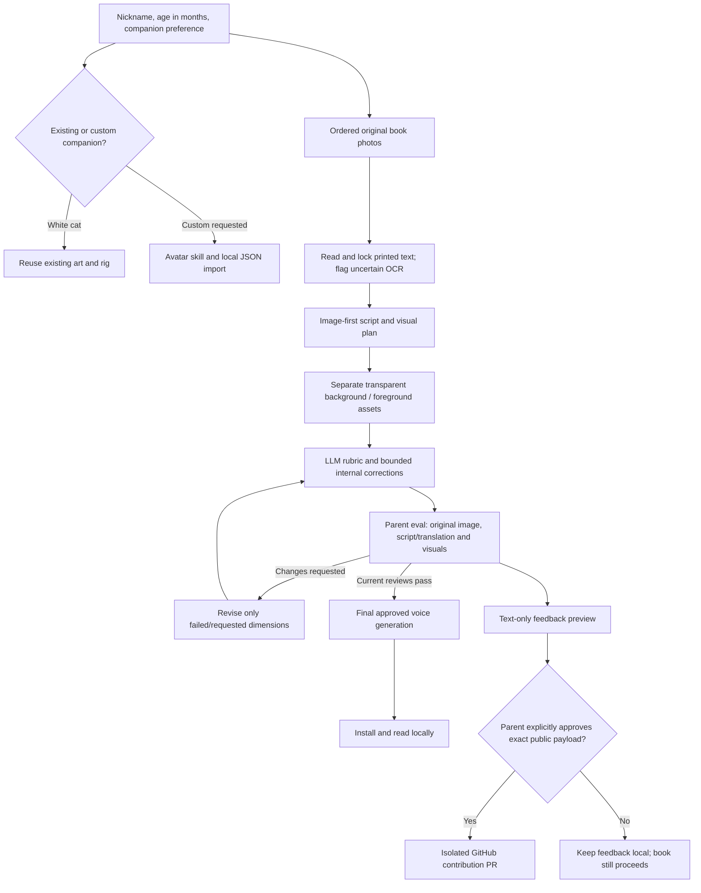

# From a parent's folder of photos to a reviewed reading experience

[Try Read for Xixi](https://storyforxixi.susiefan.com/) · [Copy the complete onboarding prompt](../prompts/photo-book-workflow.md) · [Setup skill](../skills/setup-picture-book)

The setup skill asks what the companion should call the child, the child's age and the desired companion. The existing animated white cat is ready to use; choosing it does not trigger new artwork. A requested custom animal invokes the avatar skill. The profile stays local. The current writing/voice defaults are Mandarin; an English interface is not automatic English narration.

## Workflow



## Installation and onboarding

Install README dependencies. Copy `skills/setup-picture-book` and `skills/create-reading-avatar` into your agent's skill directory (Codex: `~/.codex/skills/`), preserving their references and metadata. Then use the example prompt with your folder path. A coding assistant must work in this project checkout and actually run commands; the skill is not a hosted photo-upload service.

Generation uses the configured server-side OPENAI_API_KEY and explicit available model names. Local final speech uses an already installed CosyVoice lab and the versioned Mimi profile. Configure these once; do not put keys or child data into Git. The skill checks missing environment/voice setup early. Content sent to the optional model API includes the supplied page photos and relevant local profile; app avatar import itself is browser-local.

## 1. Prepare and generate scripts/assets

```bash
python scripts/photo_book_workflow.py prepare /path/to/book-photos \
  --book-id my-book --title 'My book' \
  --child-name '宝宝' --age-months 24 --character white-2d
python scripts/photo_book_workflow.py build data/local/books/my-book \
  --model YOUR_AVAILABLE_MODEL --visual-model YOUR_AVAILABLE_VISUAL_MODEL
```

JPEG/PNG/WebP photos are naturally ordered by filename; for ambiguous ordering, provide `--order order.json`, an array of relative filenames. Each photo is one page/spread. Original photos and their hashes stay in the private package. Source text is extracted from the image before interpretation; uncertain or cropped text is flagged for parent review. Authoring preserves that text, stores any translation separately, and writes the visual plan in the script. Background and foreground SVGs use the source page and companion style reference, then the original source and composed scene are judged together.

The shared judge is [interaction-judge.md](../prompts/interaction-judge.md), informed by the owner's actual [207 contributed review records](../evals/contributions). It checks text/evidence, natural language, age fit, invitation/clue, response coherence, emotional salience, suspense, flat style, transparency, scale and physical support. A clear error can retry up to three times; preferences do not force rewriting accepted work. AI results are labelled as AI; they do not prefill parent scores.

## 2. Parent review and targeted revisions

```bash
python evals/webapp/serve.py
```

Open the printed local address (default http://127.0.0.1:4327/) and choose the book/latest round. The left contains original page, script/translation and composed scene; the right has script 1–7 (4 passes), visual pass/fail and comments. One Save and Next action saves the page. /production shows local job/audio progress. AI transcriptions must be checked against the original photo; a script grade is not an automatic guarantee that OCR is correct.

```bash
python scripts/review_loop.py
python scripts/regenerate_page.py data/local/books/my-book p003 \
  --dimension script --feedback 'The parent’s requested correction' --model YOUR_MODEL
python scripts/photo_book_workflow.py review data/local/books/my-book
```

Revised rounds get a new version. Exact-hash passing dimensions retain their prior parent grade with source-version provenance; latest reviews must match current narration/script and actual asset hashes. For a printed-text transcription correction, explicitly correct the evidence and matching story together before regenerating that page. Final voice is blocked until each current script is >=4 and each visual has been saved as pass. The visual selection may default to pass for convenience; it still requires saving and is not presented as independent expert inspection.

## 3. Optional evaluation contribution

```bash
python scripts/export_eval_contribution.py data/local/script-evals/ratings.sqlite3 \
  --redact-name "宝宝" --output data/local/contributions/my-feedback.json
python scripts/contribute_evals.py data/local/contributions/my-feedback.json
```

This only prepares a local preview. Inspect/redact comments and show the exact payload to the parent. Explain that the contribution would be public in **susiefan/Read-for-Xixi under MIT**. Only after explicit agreement create the local hash-bound approval JSON and run `--publish --approval ...`. The helper opens an isolated GitHub PR using the parent's authenticated gh/Git identity. A changed payload invalidates consent. No response is not permission, and declining does not block the book or its voice.

Published contributions contain grades, version/page metadata and redacted editorial comments, not complete scripts, photos, book art/audio, child profiles, recordings, reviewer identity or local paths. Contextual review comments are not a full redistributable book or a blinded benchmark. The owner's existing contribution was explicitly authorized; its provenance/limits are documented with the dataset.

## 4. Final voice, install and use

```bash
python scripts/photo_book_workflow.py check-review data/local/books/my-book
python scripts/photo_book_workflow.py voice data/local/books/my-book \
  --lab /path/to/tts-lab --python /path/to/tts-lab/cosy-env/bin/python
pnpm dev
```

The exact-text voice manifest is built only after parent review. Approved profile and text hashes bind the resumable voice job. The finished book is installed into ignored public/library/; runtime metadata omits the child profile. The reviewed nickname can occur in the authored narration/interaction. Selecting a custom character changes appearance while the configured voice is reused.

All book material remains local. Publishing the code or optionally donating editorial feedback is not permission to upload the book itself. Photos-to-script and final-voice adapters are implemented, but this release's automated validation uses local fixtures/mocked provider responses rather than claiming a paid end-to-end model/TTS run for a newly uploaded parent book.

For a custom companion, prepare with `--character custom:YOUR_AVATAR_ID --avatar-file /path/to/companion.avatar.json`. The validated avatar reference is used during visual generation/judging so held/worn props fit that animal. Import that same JSON in the reader settings. Built-in white-cat selection needs no avatar file or new artwork.
