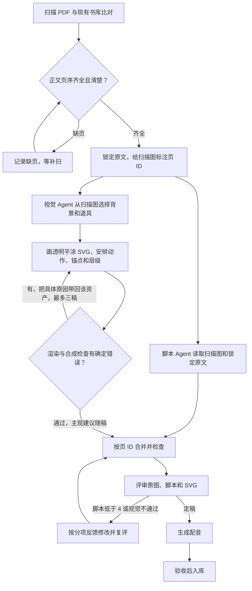

# Mimi 共读脚本评审

新版以 `interaction-author-v42-picture-clues-and-story-payoff` 和希希的 24 个月档案为基础。按书籍 ID 查系列人物，按实际月龄查发展建议。每轮评审记录书名、脚本版本和对应的原文版本。

## 逐页怎么评

每页可写 `保留` 或 `重写`。用自然语言给反馈就够了，比如「PDF 第 10 页，邀请，问希希想用彩纸做什么。把做好的星星留给回应。」可以直接改逐页评审表的「评审」一行，也可以在聊天里发书名和 PDF 页码。

| 看哪一项 | 判断标准 |
|---|---|
| 原文与页序 | 逐字对照扫描页，检查人名、对话、拟声词、标点和左右阅读顺序。缺页或无法辨认时先补源文件。发现转录错误时，记录 PDF 页和原字，再同步订正独立原文文件与脚本。 |
| 原文与画面一起读 | 先转录、核对并锁定原文，再看插图。用原文理解角色想要什么、做了什么，用画面找能指给孩子看的线索。角色的动作和感受要点出名字，例如老鼠是波西、兔子是皮普。 |
| 邀请与第一级提示 | 朗读后每页都有一个邀请。邀请内先给具体线索或动作示范，最多一个问题。封面优先聊和书名有关的可见主角或动作，再开放地问孩子注意到了什么，或联系自己的经历。 |
| 像共读时聊天 | 从当页人物想要什么、怎么对待朋友、哪件事好笑或值得关心来选话题。两岁的孩子可以用动作或一两个词参与。借玩具可以试一句怎么开口，照顾朋友可以聊当下的一件小事，到和好的页再聊和好。 |
| 孩子的参与 | 指一下、做个动作、模仿一个声音、说一两个词都可以。遇到积木、彩纸或橡皮泥，优先让孩子说自己想做什么。 |
| 看图描述 | 适合一起看图的场景，直接问看到了什么。有合适画面时，全书至少安排一次说颜色、形状或数一数。 |
| 多页连着读 | 对照邻近页的邀请，看是不是换个说法问了同一件事。同一事件的情绪问题可以留在情绪最明显的一页。等情节走到时，用一句话接回前面看过的玩具、动作或习惯。 |
| 线索、揭晓和呼应 | 有悬念时，孩子能不能靠当页一个指得出的线索，用动作或一个词参与？回应可以补一个细节，身份和结果留到原书揭晓时再确认。遇到重复出现的事物，后一次聊一个新发现。情节揭晓后，可以用两件已读到的具体小事聊朋友怎么相处。 |
| 聊借用和分享 | 说明角色做的具体小事，以及这件事为什么对角色有意义。孩子可以说愿意、不愿意，也可以安静听。像心爱玩具愿不愿意借这类话题，可以留给读完后的家长共读。 |
| 一句回应 | 用自然、简短的普通话接住邀请。可以补一个具体观察、关心角色的感受，或示范一句借用、道谢、问候的话。示范一句怎么请求，不算向孩子再提问。检查是否重述邀请、猜测孩子说了什么、提前讲出结果，或用「我们再看看这一页」填空。 |
| Live2D 视觉稿 | 在左栏对照原始扫描和合成。核对来源、剧透、平涂颜色、透明度、尺寸、遮挡和支撑关系。 |

### 回归例子

- **原文被改动**　连标点都要和锁定文字一致。
- **封面变成测验**　「你找到蜗牛了吗？」把范围缩得太小，换成开放观察。
- **漏掉封面最显眼的动作**　《大搜索》可以说「波西在玩积木，皮普在推小火车。」角色身份查系列索引，具体动作看这一页。
- **有趣的细节说得太绕**　「小青蛙没下水，头上也顶着一团泡泡。」用一句口语说出当页的反差。
- **模仿声音的措辞生硬**　遇到门铃可以直接说「叮咚」。当页最有意思的是谁在门外，就问「咦，门口有人。你猜是谁呀？」
- **复述代替交流**　如果已经读过耙地、播种、浇水，就找一个新的画面细节或邀请孩子说想种什么。
- **提示直接给答案**　「皮普很难过。皮普现在感觉怎么样？」保留面部线索即可。
- **回应换了主角**　《圣诞树》第 8 个 PDF 页问波西听完道歉的心情，回应接波西的神情和动作。
- **光看姿势误读剧情**　《最心爱的玩具》的原文说波西嫌恐龙吓人，图里她转开脸、伸出手。邀请可以请孩子看看她的反应，回应无需编出她跑开或藏起来。
- **角色在哭，话题却跳到道具**　波西想念自己的小青蛙，先和孩子看看波西的眼泪、聊她现在的感受，不转去问存钱罐的用法。
- **邀请一起玩，回应却跳题**　请孩子学皮普打招呼，Mimi 就接一句「嗨，波西！欢迎你来我家一起玩！」，明确这是 Mimi 在模仿。
- **配件或物体看起来悬空**　帽沿搭在头顶、盆沿遮住树干底部、道具落在地板或爪子上。根据剧情飞起来的蛋糕可以悬空。
- **对两岁孩子太复杂**　「波西怎样开车，才不会吓到小蜗牛？」改成「你也来假装开车吧！」
- **抓住当页的转折**　皮普绊倒时先问刚发生什么，回应把玩具巴士、绊倒和蛋糕飞起来连起来。说到蛋糕飞向波西为止。
- **创作变成选择题**　「你想用橡皮泥捏什么？」允许孩子自己想。只从图中成品里选会缩小想象空间。
- **摔倒后急着讲道理**　《滑板车》先看车轮、波西的姿势和她的表情。照顾和拥抱等到书里出现时再聊。
- **有社交情节却只找道具**　《滑板车》中，波西想骑时可以聊怎么开口借。车被拿走时可以从皮普的角度想一想。皮普来照顾她以后，Mimi 可以示范一句具体的谢谢。
- **回应像在批改孩子的答案**　离线回应可以先说 Mimi 的想法，或示范「我能玩一会儿吗？」。把进一步的对话留给家长和孩子。
- **前面看过的玩具后来派上用场**　《最心爱的玩具》先看到小猪在皮普枕头边。皮普后来把小猪递给波西，这时可以接回枕头边的小猪，让孩子明白这是他自己也喜欢的玩具。
- **看图猜测提前揭晓**　《小蜗牛》第 16–17 页让孩子看看树下露出的脚。先接住孩子留意到的细节，下一跨页再说是谁。苗床再次出现时，可以指给孩子看小牌子上写着「豆豆」，给前面的种菜话题添一个新发现。
- **把借玩具当成正确答案**　皮普愿意借小猪，是他照顾朋友的一种方式。孩子也可以把自己心爱的玩具留在身边。
- **小意外变成如厕测验**　《尿裤子》把「看看抱着小猪的皮普。他现在感觉怎么样？」留在发现水洼的那页。书后是非题另列为附加练习。

## 两轮反馈怎么进入脚本

| 版本 | 如何处理 | 留给评审的记录 |
|---|---|---|
| `v1` | 按原文与画面证据创作，运行机器检查，填写第一轮意见。 | 首轮脚本、逐页评审表。 |
| `v2` | 根据第一轮意见重写标记页，重新通读全书，检查改动是否重复了前后页。 | 保留 `v1`，在 `v2` 评审表展示改动前的邀请与回应。 |
| `v3` | 根据第二轮意见重写，再跑同一套检查；逐项复核前两轮意见。 | 保留 `v2`，交付本轮差异和仍待处理的页。 |

把意见记录成「书名 / PDF 页或跨页 ID / 文案或视觉 / 改法」。同一问题在几页反复出现时，标记为通用规则候选。个别偏好留在本书。源文件更正单独记录。脚本和 Live2D 视觉在同一轮离线评审，配音安排在定稿之后。

## 本批次工作流



[首轮评审总表](../data/local/script-evals/2026-11-09/README.md)

[并行生成命令和逐页评审工具](webapp/README.md)

本地资产先实际渲染，再在白猫舞台里检查方形、横屏和竖屏。按页记录所用原图和各稿 SVG 指纹。每个资产独立检查文件安全、透明画布、当页来源、剧透、平涂风格、舞台适配和物理支撑。确定的错误写成具体修订要求。修订稿再进入同一检查。三稿仍有确定错误时，保留错误等待处理。可靠的同义表达和画风变体可以通过，复核建议会随稿保存。

## 运行评审

在项目目录执行以下命令。`source.json` 保存已锁定的原文与画面线索，`v1.json` 是候选脚本。`--report` 会生成一份可编辑的 Markdown，并在目标文件存在时停下来保护已填写的反馈。

```bash
book_dir=data/local/script-evals/2026-11-09/christmas-tree
python3 evals/check_interaction_scripts.py "$book_dir/source.json" "$book_dir/v1.json"
python3 evals/check_interaction_scripts.py "$book_dir/source.json" "$book_dir/v2.json" \
  --previous "$book_dir/v1.json" --report "$book_dir/v2-review.md"
```

检查本批所有已起草的书时，可用同一条命令逐本运行。

```bash
for draft in data/local/script-evals/2026-11-09/*/v1.json; do
  python3 evals/check_interaction_scripts.py "${draft%/*}/source.json" "$draft" || break
done
```

机器检查覆盖相对原文清单的缺页和顺序、逐字旁白、漏写邀请或回应、多问句、常见复杂策略句式、完全重复的邀请和禁用短语。原文记录了 PDF 总页数时，还会检查正文和附加页是否覆盖整个 PDF。对已知生硬的拟声句式、全书看图描述机会和剧情焦点给出复核提醒。自然口语、语义重复、孩子能否回应、画面证据和剧透也要通读核对。原文及候选脚本位于 Git 忽略的 `data/local/`。
